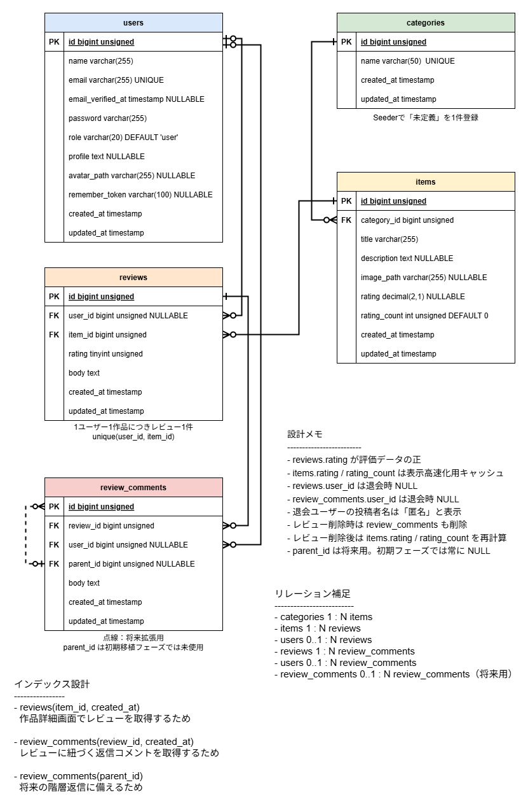

# DB設計

## このドキュメントの目的

このドキュメントでは、映画レビューアプリ Laravel移植版のDB設計を整理する。

既存スクラッチ版のDB構成をベースにしつつ、Laravelのマイグレーション、Eloquentリレーション、認証機能に合わせて再設計する。

初期移植フェーズでは、ユーザー機能の最低限移植に必要なテーブルを中心に整理する。

管理者機能やTMDB API連携はMVP1では対象外とし、MVP2で管理者画面、TMDB検索、検索結果からの1作品登録を段階的に整備する。TMDB検索・ジャンル取得・検索結果カードは`develop`へ統合済みで、登録前モーダル（Issue 230）は**作業ブランチでUI実装・ローカルテスト済み、PR前・`develop`未統合**である。カテゴリーのDB整備と作品登録は未実装とする。

ただし、DB設計は後から大きく変更すると影響範囲が広いため、カテゴリ、権限、評価キャッシュなど、将来拡張を見越した設計を初期段階で整理する。

## ER図

初期移植フェーズのDB設計をもとに、ER図を作成しています。



編集用ファイル:

- [database-er.drawio](./diagrams/database-er.drawio)

## DB設計方針

- Laravelのマイグレーションでテーブルを管理する
- Laravel Breezeの `users` テーブルをベースに認証機能を構成する
- 既存スクラッチ版のDB構成を参考にする
- レビュー本文と評価は `reviews` テーブルで一体管理し、ユーザーと作品に紐づける
- レビューへの返信コメントは `review_comments` テーブルで管理する
- 評価平均と評価件数は `items` テーブルにキャッシュとして保持する
- 外部キー制約を適切に設定する
- 初期移植フェーズでは物理削除を基本とし、退会ユーザーの投稿は投稿者情報を切り離して匿名表示する
- 論理削除は、後続フェーズで必要になった場合に検討する
- 作品一覧・作品詳細の確認に必要な最低限の作品データはSeederで用意し、既存DBデータの本格移行は後続フェーズで検討する

## 初期移植フェーズで使用する主なテーブル

| テーブル | 概要 |
|---|---|
| `users` | 会員情報を管理する |
| `categories` | 作品カテゴリを管理する |
| `items` | 映画作品情報を管理する |
| `reviews` | 作品レビューを管理する |
| `review_comments` | レビューへの返信コメントを管理する |

## users テーブル

Laravel Breezeの認証機能をベースに使用する。

| カラム | 型 | 制約・補足 |
|---|---|---|
| `id` | bigint unsigned | 主キー |
| `name` | varchar(255) | ユーザー名 |
| `email` | varchar(255) | 一意 |
| `email_verified_at` | timestamp nullable | メール認証状態。未認証時は `null`、認証完了後は日時、メールアドレス変更時は `null` |
| `password` | varchar(255) | ハッシュ化したパスワード |
| `role` | varchar(20) | 権限。初期値は `user` |
| `profile` | text nullable | 自己紹介文 |
| `avatar_path` | varchar(255) nullable | ユーザーアイコンのpublicディスク内相対パス。未設定時は `null` |
| `remember_token` | varchar(100) nullable | ログイン保持用 |
| `created_at` | timestamp | 作成日時 |
| `updated_at` | timestamp | 更新日時 |

### 補足

初期移植フェーズでは、Breeze標準の `users` テーブルをベースにする。

アカウント画面でプロフィール情報とユーザーアイコンを扱うため、Breeze標準の `users` テーブルへ、このプロジェクトで `profile` と `avatar_path` を追加している。

ユーザーアイコン機能では既存の `avatar_path` を使用するため、追加マイグレーションは行っていない。

メール認証では既存の `email_verified_at` を使用する。Laravel版はまだ本番デプロイしていないため、Issue #93では本番既存ユーザー向けのバックフィルやデータ補正用マイグレーションは追加しない。

`avatar_path` には `avatars/...` 形式のpublicディスク内相対パスを保存し、公開URL、元ファイル名、共通のNo Image画像のパスは保存しない。未設定時は `null` とする。

新画像が選択されていない場合は既存の `avatar_path` を維持し、差し替え時はpublicディスク内の新しい相対パスへ更新する。

会員退会時はDB整合性を優先して `users` レコードを物理削除するため、`avatar_path` を含む行自体が削除される。

`role` は会員と管理者の認可区分に使用する。通常会員は `user`、管理者は `admin` とし、`admin` のみ管理者画面を利用できる。管理者権限の付与方針は[セキュリティ方針](SECURITY.md)を参照する。

## categories テーブル

作品カテゴリを管理する。

| カラム | 型 | 制約・補足 |
|---|---|---|
| `id` | bigint unsigned | 主キー |
| `name` | varchar(50) | カテゴリ名。一意 |
| `created_at` | timestamp | 作成日時 |
| `updated_at` | timestamp | 更新日時 |

### 補足（MVP1の既存実装）

初期移植フェーズでは、カテゴリ検索やカテゴリ管理画面は実装しない。

ただし、`items.category_id` を必須の外部キーとして扱うため、`categories` テーブルは初期設計に含める。

初期データとして、`CategorySeeder` で `未定義` カテゴリを1件登録する。

MVP1では、Seederで用意したサンプル作品の `category_id` は `未定義` カテゴリを参照する。

カテゴリの追加・編集・検索・絞り込み機能は、別途対象を定めた後続フェーズで検討する。

### MVP2：アプリ独自カテゴリーの確定仕様（Issue 230・228）

以下は**2026-10-31時点で確定したカテゴリー仕様**であり、現行DBに12件が投入済みであることを意味しない。現行の`CategorySeeder`は、まだ「未定義」1件を登録する実装である。2026-11-01時点で、固定12候補の選択UIはIssue 230の作業ブランチで実装・ローカルテスト済みだが、DB側への12件追加と連携は未実装である。

アプリ独自カテゴリーの新規作品登録用選択肢は次の**12種類**とする。表の番号は**UI表示順**であり、`categories.id`の実値ではない。

| 表示順 | アプリ独自カテゴリー名 |
|---:|---|
| 1 | アクション |
| 2 | アドベンチャー |
| 3 | アニメーション |
| 4 | コメディ |
| 5 | ヒューマンドラマ |
| 6 | SF |
| 7 | ファンタジー |
| 8 | ホラー |
| 9 | サスペンス・ミステリー |
| 10 | 恋愛 |
| 11 | ドキュメンタリー |
| 12 | その他 |

- 「ドラマ」ではなく、**「ヒューマンドラマ」**を正式なカテゴリー名とする。
- 「その他」は、新規登録時に上記のほかのカテゴリーへ分類しにくい作品に使用できる。
- 既存の**「未定義」はDBから削除しない**。`ItemSeeder`と既存作品の参照関係を維持するため、DB上の管理対象カテゴリーは「未定義」を含めて**計13種類**となる。
- ただし「未定義」は**新規作品登録用の選択肢に表示せず、登録APIでも指定を拒否する**。これはIssue 228でサーバー側にも適用する。
- 既存の`categories`テーブルには表示順カラムがない。表示順は上記の仕様として管理し、`categories.id`の大小やDBの暗黙的な取得順に依存しない。表示順の実装方法はIssue 228で決定する。
- 1作品につきアプリ独自カテゴリーは**1件のみ**選択・保存する。TMDB由来の複数ジャンルは参考情報であり、アプリカテゴリーへ自動変換・自動選択しない。
- カテゴリーの追加・編集・削除を行う管理画面は、Issue 230・228の対象外とする。

**Issueごとの責務（2026-11-01時点）：**

- **Issue 230（登録前モーダル・作業ブランチでUI実装済み）**：上記12件を固定のUI候補として表示し、初期状態は「カテゴリーを選択してください」（未選択）とする。DBへの候補問い合わせ、仮の`categories.id`の割り当て、作品登録処理は行わない。登録ボタンは無効のままである。PR前であり`develop`統合済みとは扱わない。
- **Issue 228（現行の後続計画・未実装）**：`CategorySeeder`へ12件を追加し、既存の「未定義」のIDおよび既存作品の外部キーを維持する。Seeder再実行時に重複登録や既存データの無条件削除を行わない。UI候補を実DBのカテゴリーへ対応させ、実在する`categories.id`を`category_id`としてサーバー側で検証・保存する。存在確認だけで済ませず、「未定義」および許可対象外のカテゴリーを新規登録で拒否する。
- **テストデータ**：通常開発用の`DatabaseSeeder`とPlaywright用の`E2eSeeder`は別の投入経路である。後続のDB実装・登録機能で、E2E環境でも正式12カテゴリーを使うテストが成立するようfixtureを整合させる。専用DBの安全な初期化手順は[Playwright運用ガイド](PLAYWRIGHT_TESTING.md)に従う。

**後続Issueの分割案（検討中・未起票）**：現行Issue 228の範囲を、①DB詳細設計と入力契約の確定、②マイグレーション・Seeder・既存機能の回帰テスト、③登録API・保存・重複防止に分け、フロント入力検証・エラー表示も別Issueとする案を検討している。**新しいIssue番号や責務移管はまだ確定していない。** 正式な分割まではIssue 228を現行の後続計画として扱う。

作品登録時の編集項目とモーダルのARIA・キーボード操作については、[TMDB映画検索 技術設計](TMDB_SEARCH_DESIGN.md)のIssue 230設計を参照する。DBへ保存する`tmdb_id`等のカラムの最終仕様は後続のDB詳細設計で確定する。

## items テーブル

映画作品情報を管理する。

| カラム | 型 | 制約・補足 |
|---|---|---|
| `id` | bigint unsigned | 主キー |
| `category_id` | bigint unsigned | `categories.id` への外部キー |
| `title` | varchar(255) | 作品タイトル |
| `description` | text nullable | 作品説明 |
| `image_path` | varchar(255) nullable | 作品画像パス |
| `rating` | decimal(2,1) nullable | 平均評価キャッシュ |
| `rating_count` | int unsigned | 評価件数キャッシュ。初期値は 0 |
| `created_at` | timestamp | 作成日時 |
| `updated_at` | timestamp | 更新日時 |

### 補足

`items.category_id` は `categories.id` に紐づける。

初期移植フェーズでは、カテゴリ検索やカテゴリ管理画面は作成しない。

MVP1のサンプル作品では、Seederで登録する `未定義` カテゴリを作品のカテゴリとして使用する。MVP2の新規作品登録では、上記の確定済み12カテゴリーから選択した1件を保存する方針だが、**実DB連携・保存は未実装**であり、現行Issue 228の後続範囲である。DB設計・実装を独立Issueへ分割する案は検討中とする。

現行`items`の`title`は`varchar(255)`、`description`は`text nullable`、`category_id`は必須の外部キーである。登録前モーダルの編集UIは作業ブランチで実装済みだが、**タイトル・概要・カテゴリーのフロント入力検証と項目別エラー表示は未実装**である。後続の入力契約設計では、DB制約と整合する必須性・上限・空白処理・文字数の計測方法を確定し、サーバー側検証を正としたうえでフロントの検証・ARIA表示と一致させる。

作品一覧・作品詳細の動作確認に必要な最低限の作品データは、`ItemSeeder` で用意する。

初期移植フェーズでは、既存スクラッチ版MySQLバックアップから作品データを加工して利用することを検討する。

ただし、既存DBデータの本格移行は初期移植フェーズでは対象外とする。

スクラッチ版から利用する場合も、Laravel版の `items` テーブル構造に合わせて、カラム名、カテゴリID、画像パス、文字コード、NULL許容、外部キー制約を確認してから投入する。

レビュー、評価、ユーザー、レビュー返信コメントの移行は、Laravel Breezeの認証構造や評価キャッシュとの整合が必要になるため、初期移植フェーズでは原則として対象外とする。

### 評価キャッシュ方針

`items.rating` と `items.rating_count` は、`reviews.rating` の集計結果をキャッシュする。

作品一覧や作品詳細で毎回集計するとDB負荷が増えるため、評価投稿・更新時にキャッシュを更新する方針とする。

初期移植フェーズでは、以下の方針とする。

- `reviews.rating` を評価データの正とする
- `items.rating` には平均評価を保持する
- `items.rating_count` には評価件数を保持する
- `items.rating` / `items.rating_count` は表示高速化用のキャッシュとして扱う
- レビュー投稿・削除時は、対象作品の平均評価と評価件数を再計算する
- キャッシュ更新処理はトランザクション内で行う

初期移植フェーズでは、レビュー投稿・削除時に対象作品のレビューを再集計し、`items.rating` と `items.rating_count` を更新する。

同時投稿・同時削除による競合対策は、初期移植フェーズでは過度に複雑化させず、トランザクション内での再集計を基本とする。

将来的にレビュー投稿数が増え、同時更新による不整合が問題になる場合は、行ロック、集計クエリの見直し、非同期再集計などを検討する。

## reviews テーブル

作品レビューを管理する。

レビュー本文と評価は一体の投稿として扱う。

| カラム | 型 | 制約・補足 |
|---|---|---|
| `id` | bigint unsigned | 主キー |
| `user_id` | bigint unsigned nullable | `users.id` への外部キー。退会により投稿者ユーザーが存在しない場合は `null` とし、画面上では投稿者名を「匿名」と表示する |
| `item_id` | bigint unsigned | `items.id` への外部キー |
| `rating` | tinyint unsigned | 評価。1〜5 |
| `body` | text | レビュー本文 |
| `created_at` | timestamp | 作成日時 |
| `updated_at` | timestamp | 更新日時 |

### 制約・インデックス

- 1ユーザーが1作品に投稿できるレビューは1件までとする
- `user_id` と `item_id` の組み合わせにユニーク制約を設定する
- 作品詳細画面でレビューを取得するため、`item_id` と `created_at` の組み合わせにインデックスを設定する
- `rating` は1〜5の範囲とする

```text
unique(user_id, item_id)
index(item_id, created_at)
```

`user_id` は会員退会時に `null` になり得る。
MySQLではユニーク制約に含まれる `null` は複数許容されるが、退会済みユーザーのレビューは重複投稿制御の対象外とする。

初期移植フェーズでは、`rating` のDB CHECK制約は設定しない。

`rating` の1〜5の範囲制限は、Form RequestとFeatureテストで保証する。

DB CHECK制約は、Laravel 10のマイグレーションではraw SQLが必要になる可能性があるため、初期移植フェーズでは実装・保守の負担を避ける。

将来的にDB側でも厳密に保証したい場合は、MySQLバージョン、Laravelマイグレーション方針、運用コストを確認したうえで再検討する。

## review_comments テーブル

レビューへの返信コメントを管理する。

| カラム | 型 | 制約・補足 |
|---|---|---|
| `id` | bigint unsigned | 主キー |
| `review_id` | bigint unsigned | `reviews.id` への外部キー |
| `user_id` | bigint unsigned nullable | `users.id` への外部キー。退会により投稿者ユーザーが存在しない場合は `null` とし、画面上では投稿者名を「匿名」と表示する |
| `parent_id` | bigint unsigned nullable | 将来の返信への返信用。初期移植フェーズでは使用せず、外部キー制約は設定しない |
| `body` | text | 返信本文 |
| `created_at` | timestamp | 作成日時 |
| `updated_at` | timestamp | 更新日時 |

### 制約・インデックス

- レビューに紐づく返信コメントを取得するため、`review_id` と `created_at` の組み合わせにインデックスを設定する
- 将来の階層返信に備えるため、`parent_id` にインデックスを設定する

```text
index(review_id, created_at)
index(parent_id)
```

### 補足

レビューへの返信は `review_comments` テーブルで管理する。

初期移植フェーズでは、レビューに対する1階層コメントのみ対応する。

返信コメントへの返信は、初期移植フェーズでは実装しない。

ただし、将来的な多階層返信に備えて、`parent_id` を用意する。

初期移植フェーズでは `parent_id` は使用せず、常に `null` とする。

`parent_id` は将来の階層返信に備えたカラムだが、初期移植フェーズでは外部キー制約を設定しない。

将来、返信コメントへの返信を実装する場合は、`parent_id` の外部キー制約と削除時動作を再検討する。

会員退会時は `users` レコードを物理削除するが、投稿済みのレビューコメント本文は削除しない。

退会により投稿者ユーザーが存在しないレビューコメントは、画面上では投稿者名を「匿名」と表示する。

編集・削除は後続フェーズで検討する。

## リレーション設計

### User

| リレーション | 内容 |
|---|---|
| `reviews()` | ユーザーは複数のレビューを持つ |
| `reviewComments()` | ユーザーは複数のレビューコメントを持つ |

### Category

| リレーション | 内容 |
|---|---|
| `items()` | カテゴリは複数の作品を持つ |

### Item

| リレーション | 内容 |
|---|---|
| `category()` | 作品は1つのカテゴリに属する |
| `reviews()` | 作品は複数のレビューを持つ |

### Review

| リレーション | 内容 |
|---|---|
| `user()` | レビューは1人のユーザーに属する。退会により投稿者ユーザーが存在しない場合は `null` になり得る |
| `item()` | レビューは1つの作品に属する |
| `comments()` | レビューは複数のレビューコメントを持つ |

### ReviewComment

| リレーション | 内容 |
|---|---|
| `user()` | レビューコメントは1人のユーザーに属する。退会により投稿者ユーザーが存在しない場合は `null` になり得る |
| `review()` | レビューコメントは1つのレビューに属する |
| `parent()` | レビューコメントは親コメントを持つ場合がある。初期移植フェーズでは使用しない |
| `children()` | レビューコメントは複数の子コメントを持つ場合がある。初期移植フェーズでは使用しない |

## 削除時の方針

外部キーの削除時動作は以下の方針とする。

| 対象 | 削除時の動作 | 理由 |
|---|---|---|
| `reviews.user_id` | `nullOnDelete` | 会員退会後もレビュー本文を残し、投稿者を匿名表示するため |
| `review_comments.user_id` | `nullOnDelete` | 会員退会後もレビュー返信本文を残し、投稿者を匿名表示するため |
| `reviews.item_id` | `cascadeOnDelete` | 作品削除時に紐づくレビューを残さないため |
| `review_comments.review_id` | `cascadeOnDelete` | レビュー削除時に紐づく返信コメントを残さないため |
| `review_comments.parent_id` | 初期移植フェーズでは外部キー制約なし | 将来の階層返信用カラムであり、初期移植フェーズでは常に `null` として扱うため |

### レビュー削除時

会員は、自分が投稿したレビューのみ削除できる。

レビュー本文と評価は `reviews` テーブルで一体管理するため、レビュー削除時は本文と評価の両方を削除する。

レビューが削除された場合、そのレビューに紐づく `review_comments` も削除する。

レビュー削除後は、対象作品の平均評価と評価件数を再計算し、`items.rating` と `items.rating_count` を更新する。

### 会員退会時

会員退会時は、`users` レコードを物理削除する。

ただし、退会ユーザーが投稿したレビュー本文およびレビューコメント本文は削除せず、表示履歴として残す。

そのため、`reviews.user_id` および `review_comments.user_id` は、投稿者ユーザーが存在しない場合に `null` になり得る。

投稿者ユーザーが存在しないレビュー・レビューコメントは、画面上では投稿者名を「匿名」と表示する。

退会後のレビュー・レビューコメントは、投稿者との紐づきがなくなるため編集不可とする。

退会時は、`users` レコードの削除と投稿者との紐づきの更新を含むDB整合性を優先する。アイコンファイルの削除順序と失敗時の扱いは `docs/IMPLEMENTATION_PLAN.md` に整理する。

退会ユーザーのお気に入りデータは、将来お気に入り機能を追加した場合も削除する方針とする。

### 作品削除時

作品削除はMVP2対象外の将来候補とする。

将来、作品削除機能を実装する場合、作品が削除されたときは、その作品に紐づくレビューも削除する。

レビューが削除されるため、そのレビューに紐づく `review_comments` も削除する。

作品削除は影響範囲が大きいため、実装時は確認画面または確認モーダルで、関連するレビュー・レビューコメントも削除されることを明示する。

## MVP2以降の設計

以下はMVP2の現在仕様と今後の設計事項を整理する。MVP2対象と将来候補を区別し、未確定事項を現在のDB仕様として扱わない。

### 管理者機能

- `users.role` は通常会員の `user` と管理者の `admin` を区分し、管理者画面の認可に使用する
- MVP2では管理画面ダッシュボードと登録済み作品一覧を扱う
- 作品詳細モーダル、作品編集・削除、管理者操作ログはMVP2対象外の将来候補とする

### TMDB API連携

TMDB API連携、映画検索、検索結果からの1作品ずつの登録、重複登録防止はMVP2の対象である。検索・複数ジャンル取得・カード表示改善は`develop`へ統合済み。検索結果から登録前モーダルを開き、作品タイトル・概要を編集し、アプリ独自カテゴリーを1件選択するUIは、**Issue 230の作業ブランチで実装・ローカルテスト済み（PR前）**である。ただし、登録ボタンは無効であり、フロント入力検証・カテゴリーDB連携・登録API・DB保存・重複登録防止は未実装である。これらは現行Issue 228の後続計画に含まれ、DB設計／DB実装／フロント入力検証を独立Issueに分割する案は未確定とする。

既存文書では以下のカラム追加を候補としていたが、採用フィールド、DB保存項目、`tmdb_id`の最終仕様は未確定である。後続のTMDB技術調査・DB設計で決定し、現行スキーマまたは確定仕様として扱わない。

| カラム | 概要 |
|---|---|
| `tmdb_id` | TMDB上の作品ID |
| `poster_path` | TMDBのポスター画像パス |
| `release_date` | 公開日 |
| `original_title` | 原題 |
| `overview` | TMDBから取得した概要 |

上表は追加候補を列挙したものであり、**現行の`items`テーブルに実装済みのカラムではない**。TMDB IDの型・NULL許容・一意性制約、既存作品の扱い、ポスターの保存対象と利用条件、編集後の概要をどのカラムに保存するかは、後続のDB詳細設計で確定する。候補をそのまま全件追加すると決定したものではない。

### TMDB作品登録に伴うDB変更と回帰テスト（後続の設計・実装時に実施）

DBスキーマ変更が必要になった場合、LaravelのマイグレーションとSeederを**作品登録APIとは独立して検証できる工程**に分ける案を検討する。以下はテスト計画であり、変更済み・実行済みを意味しない。

- **マイグレーション**：新規DBだけでなく、既存`items`・`categories`・`reviews`・`review_comments`を保持する状態からの適用可否を確認する。既存作品の主キー・カテゴリー外部キー、レビューと返信の関連、`rating`・`rating_count`を破壊しないことを検証する。
- **カテゴリーSeeder**：「未定義」を残し、正式12件を追加できることを確認する。再実行による重複・既存IDの変更・既存作品の無条件削除が起きないことを検証する。UI表示順とDBの主キーを混同しない。
- **TMDB作品識別と一意性**：保存するTMDB IDの仕様を確定した後、既存作品との共存、NULLの扱い、重複・競合時のDB制約をテストする。実装前に`tmdb_id`の型・索引・一意制約を断定しない。
- **既存機能の回帰**：作品一覧・詳細、レビュー・返信、評価キャッシュ、Factory・Seeder、管理者TMDB検索を確認する。追加のDB操作を伴う作品登録のトランザクション境界は、登録処理の設計時に決める。
- **環境とデータ保護**：テスト専用DBの安全ガードを確認し、破壊的なDB再構築コマンドを通常開発DBや既存データ保持の検証環境に実行しない。専用DBを初期化して通るテストと、既存データを保持した状態からの変更検証は分ける。

関連するLaravel公式資料：[マイグレーション](https://laravel.com/docs/13.x/migrations)、[Seeder](https://laravel.com/docs/13.x/seeding)、[DBトランザクション](https://laravel.com/docs/13.x/database#database-transactions)。

### アクセス数・集計機能

管理者機能でアクセス数や利用状況を確認する場合、以下を検討する。

- 作品ごとのアクセス数
- 作品詳細表示回数
- レビュー投稿数
- 星評価投稿数
- 日別集計テーブル

### お気に入り機能

お気に入り機能は後続フェーズで実装する。

追加する場合は、`favorites` テーブルを作成し、`users` と `items` の多対多関係として管理する。

想定カラム:

| カラム | 概要 |
|---|---|
| `id` | 主キー |
| `user_id` | お気に入りしたユーザーID |
| `item_id` | お気に入りされた作品ID |
| `created_at` | 作成日時 |
| `updated_at` | 更新日時 |

同一ユーザーが同一作品を重複してお気に入り登録できないように、`user_id` と `item_id` の組み合わせを一意にする。

会員退会時は、退会ユーザーのお気に入りデータを削除する方針とする。

### 問い合わせフォーム機能

問い合わせフォームのメール送信はMVP2で対応する。問い合わせ内容のDB保存と管理者による問い合わせ管理はMVP2対象外の将来候補とする。

将来、問い合わせ管理を追加する場合は、`contacts` テーブルを作成して問い合わせ内容を管理する案を再検討する。

ログインユーザーからの問い合わせは `user_id` に紐づけ、ゲストからの問い合わせは `user_id` を `null` とする方針を検討する。

想定カラム:

| カラム | 概要 |
|---|---|
| `id` | 主キー |
| `user_id` | 問い合わせしたユーザーID。ゲストの場合は `null` |
| `name` | 問い合わせ者名 |
| `email` | 返信先メールアドレス |
| `subject` | 件名 |
| `body` | 問い合わせ本文 |
| `status` | 対応状況 |
| `created_at` | 作成日時 |
| `updated_at` | 更新日時 |

`status` では、未対応・確認済み・返信済み・対応完了などの状態管理を想定する。

## 補足

このドキュメントでは、DB設計とリレーション方針を整理する。

具体的なマイグレーションファイルは、実装フェーズで作成する。

ルーティング設計は docs/ROUTES.md に整理する。

認証・認可の詳細は docs/SECURITY.md に整理する。
